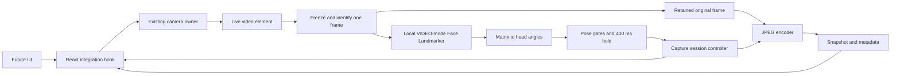

# Automatic multi-perspective camera capture — implementation specification

Version: 1.0 · October 10, 2026 · Status: specification for implementation and testing

**Scope update:** The active first round is defined in the [front-only specification](front-capture-spec.md): one automatic front-facing photo with guided angle/position checks and a future AWS Strands handoff. This broader multi-perspective design is retained for later reference; its three-view and worker/browser scope does not apply to the first round. Implementation remains paused.

This document specifies the local camera and frame-selection component. It does not implement it. The user has adopted the angle and hold settings below. Other engineering choices are proposed implementation defaults and must be validated on the target browsers and cameras.

## 1. Required outcome and boundary

After a consenting participant starts a capture session, the application watches the camera locally and automatically saves three snapshots: front, participant-left, and participant-right. Each snapshot must come from the exact camera frame whose estimated pose completed the qualifying hold. There is no shutter click for individual views.

The capture engine must work independently of the final UI. A future UI starts/stops the session, displays guidance and progress, previews results, and offers retakes through a defined interface. A minimal development screen is sufficient for initial verification.

The output is a local JPEG Blob plus metadata for each view. The handoff ends there. AWS integration, uploads, reverse-image search, identity recognition, profile discovery, and summarization are outside this component. The existing Python photo checkpoint remains a separate development tool.

## 2. Agreed capture settings

Angles describe head orientation relative to the camera, not the direction of the eyes. Left and right always mean the participant's own left and right.

| Setting | Initial value | Meaning |
| --- | --- | --- |
| Front yaw | 0°, tolerance ±5° | Accept −5° through +5° |
| Left yaw | −30°, tolerance ±5° | Accept −35° through −25° |
| Right yaw | +30°, tolerance ±5° | Accept +25° through +35° |
| Pitch, every view | 0°, tolerance ±5° | Head looking approximately level |
| Roll, every view | 0°, tolerance ±5° | Head approximately upright |
| Qualifying hold | At least 400 ms | Every processed sample in the hold passes all gates |
| Automatic results | One successful snapshot per view | Three successful snapshots complete the session |

The signed yaw convention above is an application convention: negative is participant-left, positive is participant-right. The MediaPipe adapter must convert to it. Define positive pitch as looking up and positive roll as tilting toward the participant's right shoulder.

Matching tolerance is the permitted difference from the target. For example, 28° passes a +30° target with ±5° tolerance; 36° fails. Use unrounded measurements for gating and inclusive boundaries. Round only for display. The tolerance does not establish the accuracy of the physical angle estimate or certify image quality.

Proposed session order: **front → left → right**. Only the active target may trigger a capture. Keep targets and tolerances in configuration so a later UI can choose other sets without rewriting capture logic.

## 3. Existing project and intended changes

The repository currently contains a manual browser camera flow despite the historical implementation-paused note in `agents.md`. This specification does not change that work-status instruction.

| Existing file | Current behavior | Implementation responsibility |
| --- | --- | --- |
| `frontend/src/hooks/useCamera.ts` | Owns camera stream, permissions, playback, switching, cleanup, and manual JPEG capture | Retain camera ownership; expose an active video source to the automatic-capture adapter |
| `frontend/src/faceAnalysis.ts` | `PhotoAnalyzer` analyzes already-captured JPEGs in `IMAGE` mode | Keep manual analysis separate; extract shared result serialization if helpful |
| `frontend/src/App.tsx` | Manual shutter, snapshot cards, download URLs, analysis retries | Later consume the new hook and adapt automatic results into cards |
| `frontend/scripts/prepare-vision.mjs` | Copies local model and WASM assets before dev/build | Reuse asset preparation and base-path handling |
| `frontend/tests/camera.spec.ts` | Camera, local analysis, resource and browser regression tests | Preserve existing coverage and add automatic-capture scenarios |
| `face_landmarker.py`, `photo_checkpoint.py` | Python still-image checkpoint | No dependency on these from the browser capture engine |

The installed and locked browser package is `@mediapipe/tasks-vision` **1.1.0**. Implement against its actual TypeScript declarations. Pin the model checksum in build metadata; do not silently change SDK or model versions while evaluating pose thresholds.

## 4. Component architecture



Keep angle math and the session state machine as plain TypeScript without React, CSS, browser permission calls, or network calls. Inject the clock, detector, frame source, encoder, and ID generator so their behavior can be verified with deterministic fixtures.

Proposed modules:

| Module under `frontend/src/` | Owns |
| --- | --- |
| `capture/types.ts` | Configuration, state, event, and metadata contracts |
| `capture/defaults.ts` | Versioned default preset and runtime validation |
| `capture/pose.ts` | Matrix validation, rotation extraction, semantic angle conversion |
| `capture/gates.ts` | Single-frame qualification and rejection reasons |
| `capture/session.ts` | Target order, hold, reservations, completion, cancellation, retakes |
| `capture/frameSource.ts` | Fresh-frame scheduling, freezing pixels, frame IDs and timestamps |
| `capture/videoAnalyzer.ts` | Stable detector interface and execution-mode selection |
| `capture/faceLandmarker.worker.ts` | Worker-owned detector lifecycle and inference |
| `capture/snapshotEncoder.ts` | Encode frozen original pixels and construct result metadata |
| `hooks/useAutoCapture.ts` | React subscription and coordination with `useCamera` |

The original `useCamera.capture()` grabs whatever frame is current when called. Do not call it after an earlier pose result passes: the participant could have moved. Automatic capture must encode its retained, already-analyzed source frame.

## 5. Detector and browser execution

Create a dedicated detector for a video-source lifetime and reuse it sequentially:

```ts
{
  baseOptions: {
    modelAssetPath: `${assetRoot}/face_landmarker.task`,
    delegate: 'CPU',
  },
  runningMode: 'VIDEO',
  numFaces: 2,
  outputFacialTransformationMatrixes: true,
  outputFaceBlendshapes: false,
  minFaceDetectionConfidence: 0.5,
  minFacePresenceConfidence: 0.5,
  minTrackingConfidence: 0.5,
}
```

Use `detectForVideo(frame, timestampMs)`, with strictly increasing timestamps per detector instance. The installed API requires the timestamp argument. Web uses `VIDEO` for camera streams; do not copy Python's `LIVE_STREAM` mode into JavaScript. [FaceLandmarker API](https://developers.google.com/edge/api/mediapipe/js/tasks-vision.facelandmarker)

Two-face capacity lets the application block capture when multiple faces are detected; a count of two means at least two within the detector's cap. One detected face does not prove nobody else is present. The three 0.5 values are model confidence thresholds, separate from angular tolerances, and are not per-frame angular accuracy scores.

MediaPipe's web inference calls are synchronous. Prefer a Web Worker so repeated inference does not block UI interaction. Google also documents smoothing only for `numFaces = 1`; this design uses two faces and must not assume built-in temporal smoothing. [MediaPipe web guide](https://developers.google.com/edge/mediapipe/solutions/vision/face_landmarker/web_js)

Execution strategy:

1. Try a worker with its own supported OffscreenCanvas and detector, transferring an ImageBitmap derived from frozen pixels. Explicitly verify initialization and one inference; feature existence alone is insufficient.
2. If the worker path is unsupported, use a separate DOM canvas and rate-limited main-thread inference through the same analyzer interface. Preserve the existing project's ability to operate without ImageBitmap/OffscreenCanvas.
3. Expose `executionMode: 'worker' | 'main-thread'` and measured latency for diagnostics. Do not claim every browser supports the worker path before testing it.
4. Distinguish capability errors from a missing model/WASM file. Asset errors need a recoverable error and retry, not repeated worker/main-thread retries.
5. Allow only one inference in flight, including frame preparation. Drop opportunities while busy; do not queue camera frames. Cancel/release transferables when a session becomes obsolete.

Model and WASM assets stay on the application's origin. No camera pixels or facial data are uploaded by this feature. Do not fetch models from a CDN at runtime.

## 6. Camera frames, timing, and snapshot integrity

Additional proposed defaults, separate from the agreed angle preset:

| Parameter | Initial value | Rationale |
| --- | --- | --- |
| Camera preference | User-facing; ideal 1280 × 720, ideal 30 fps | Suitable self-capture starting point; accept negotiated dimensions |
| Analysis rate cap | 10 frames/second | Initial responsiveness/performance tradeoff |
| Analysis image size | Longest edge at most 640 px | Preserve aspect ratio; no crop, letterbox, or upscale |
| Maximum analyzed-sample gap | 250 ms | A stalled stream cannot satisfy a hold |
| Maximum result age at gate evaluation | 250 ms | Reject results too old to guide the current session |
| Output | JPEG, requested quality 0.92 | Reuse the current capture format |
| Output dimensions | Frozen source frame's actual dimensions | Retain the camera's delivered resolution |
| Numeric UI updates | At most 10/second | Do not put every landmark in React state |

`useCamera` currently prefers `environment`; the future self-capture integration should make facing preference configurable, defaulting to `user` for this flow. An explicit selected device takes precedence. Do not require an unavailable resolution or frame rate.

For each analyzed sample:

1. Schedule from `requestVideoFrameCallback` when available; fall back to `requestAnimationFrame` and a changed `video.currentTime` check. A display refresh without a new video frame must not count as a new sample. `mediaTime` is in seconds and identifies the media timeline. [Video-frame callback documentation](https://developer.mozilla.org/en-US/docs/Web/API/HTMLVideoElement/requestVideoFrameCallback)
2. Confirm the session is running, the page is visible, the camera is active, and video dimensions and ready state are valid.
3. Set the busy latch before any asynchronous preparation. Assign a session ID, generation token, source epoch, frame ID, and strictly increasing sequence number.
4. Synchronously draw the unmirrored video pixels to an original-size canvas. Record `sampledAtMonoMs = performance.now()`, media timestamp, and a UTC wall timestamp at this point. These represent application sampling, not a guaranteed sensor exposure time.
5. Derive the smaller inference image from this frozen canvas. Retain the original unchanged until the result is discarded or encoding completes. Do not read from the live video again for this sample.
6. Run inference with the sample's monotonic timestamp. Retain media time separately for duplicate-frame checks. Recreate the detector on source changes; do not reset timestamps on a reused instance.
7. Deep-copy result data that must survive the next inference. Associate the result only with its original IDs and pixels. The worker echoes the main-thread timestamp; do not subtract clocks from different execution contexts.
8. Evaluate the gates. If capture is reserved, encode the retained original canvas. Otherwise release it for reuse. Hold the latch through encoding so that reuse cannot overwrite a candidate.

The final JPEG is a compressed representation of the qualifying frame, not a later frame. Preserve original pixels without preview mirroring, landmark drawings, labels, or cropping. An optional overlay is a separate artifact. Record inference dimensions alongside original dimensions so normalized landmarks can be drawn correctly.

## 7. Head-angle estimation contract

Use the transformation matrix belonging to the sole detected face. Reject missing, non-finite, malformed, singular, or reflected transforms. Do not derive degrees from an uncalibrated nose-to-eye pixel ratio.

The upstream face-geometry schema describes a 4 × 4 transform with uniform scale, rotation, and translation, with last row `[0, 0, 0, 1]`. Extract orientation after removing uniform scale. [Face geometry schema](https://github.com/google-ai-edge/mediapipe/blob/master/mediapipe/tasks/cc/vision/face_geometry/proto/face_geometry.proto)

Matrix handling is a mandatory early verification task:

- The installed JS `Matrix` type exposes only `rows`, `columns`, and flattened `data`; it does not state layout. The upstream protobuf defaults to column-major and the JS adapter forwards packed data. Start with that expected layout, then verify it against fixtures from the pinned runtime. Never infer correctness from an identity matrix alone. [Matrix schema](https://github.com/google-ai-edge/mediapipe/blob/master/mediapipe/framework/formats/matrix_data.proto), [JS result conversion](https://github.com/google-ai-edge/mediapipe/blob/master/mediapipe/tasks/web/vision/face_landmarker/face_landmarker.ts)
- For verified column-major data, element `M[row][column] = data[column * 4 + row]`. Verify that the last row is approximately `[0, 0, 0, 1]`, including real transforms with nonzero translation.
- Extract the upper-left 3 × 3 block `A`. Compute positive uniform scale as the mean length of its three columns; divide by it to obtain `R`.
- Proposed numeric checks: scale greater than `1e-6`, last-row deviations below `1e-3`, `||RᵀR − I||F ≤ 0.02`, and `|det(R) − 1| ≤ 0.02`. Treat these as numeric validation defaults to confirm against actual outputs. Fail with `pose_unavailable`; do not silently reinterpret layout or flip an invalid matrix.

Use one documented Euler decomposition throughout. For a normalized mathematical rotation `R = Rz(roll) · Ry(yaw) · Rx(pitch)`, with zero-based row/column indexing:

```text
yaw   = asin(clamp(-R[2][0], -1, 1))
pitch = atan2(R[2][1], R[2][2])
roll  = atan2(R[1][0], R[0][0])
degrees = radians × 180 / π
```

Those formulas describe mathematical axes. A dedicated, versioned adapter must map the MediaPipe basis and signs to the participant-relative convention in section 2. Verify front, left, right, up, down, and both shoulder tilts with real labeled frames. Do not guess signs from a mirrored preview. Reject near-singular Euler cases rather than reporting a plausible-looking angle; the selected targets are far from ±90° yaw.

Acceptance requires synthetic rotation fixtures, including combined rotations and non-unit scale, plus real-camera direction checks. Physical angular accuracy requires independent reference positioning; a visually plausible overlay is not sufficient evidence of degree accuracy.

Version 1 uses camera-relative zero with no automatic participant re-zeroing. Treating the first observed pose as zero could wrongly classify an already-turned head as frontal. If systematic offsets are found, evaluate a documented calibration procedure before adding it.

Use unsmoothed, validated per-frame angles for capture eligibility. A later UI may smooth displayed angles, but smoothing must not hide a failing raw sample or qualify an out-of-range snapshot.

## 8. Capture gates and the 400 ms hold

A frame qualifies only when all conditions pass:

| Gate | Pass condition | Failure reason |
| --- | --- | --- |
| Session/source | Running, active target, visible page, active camera | `paused` / `camera_not_ready` |
| Freshness | New source frame; current generation; age ≤250 ms | `stale_frame` |
| Face count | Exactly one detected face | `no_face` / `multiple_faces` |
| Pose | Valid matrix and finite supported angles | `pose_unavailable` |
| Yaw | `abs(measuredYaw − targetYaw) ≤ 5` | `yaw_out_of_range` |
| Pitch | `abs(measuredPitch) ≤ 5` | `pitch_out_of_range` |
| Roll | `abs(measuredRoll) ≤ 5` | `roll_out_of_range` |
| View slot | Active view is neither reserved nor already complete | No additional capture |

All failed reasons may be returned; choose a stable primary reason for UI guidance. Face/source failures take priority over angle instructions. Do not use rounding or widened exit thresholds to grant eligibility.

Hold algorithm, using sampled timestamps rather than result-delivery time:

```text
on a current, fresh, distinct result:
    if its gap from the previous valid sample exceeds 250 ms:
        clear hold
    if any frame gate fails:
        clear hold
        emit feedback
        release frozen pixels
        return
    if hold has not started:
        holdStart = sample.sampledAtMonoMs
    elapsed = sample.sampledAtMonoMs - holdStart
    emit hold progress = min(elapsed / 400, 1)
    if elapsed >= 400 and at least 3 distinct qualifying samples exist:
        reserve active target synchronously
        encode this sample's frozen original pixels
        commit only if generation and reservation still match
```

Also expire displayed hold progress when no new valid sample arrives within 250 ms. That watchdog may clear a hold but must never trigger capture. At the 10 Hz target, a typical hold needs samples at approximately 0, 100, 200, 300, and 400 ms; the first sample is time zero, not 100 ms of accumulated evidence.

“Continuous” means continuous across observed samples with bounded gaps. The system cannot prove the pose of every unprocessed frame. A repeated frame, long processing stall, missing face, camera change, pause, visibility change, or any out-of-range angle restarts the hold.

The 400 ms rule is a dwell rule, not a guarantee of motionlessness or sharpness. Version 1 does not add arbitrary universal blur or lighting thresholds. Record visual-quality observations during testing; if sharpness/exposure gates are required, calibrate their measurements and thresholds as a subsequent explicit requirement.

## 9. Session states, duplicates, and cancellation

| State | Meaning | Main exits |
| --- | --- | --- |
| `idle` | No active session | Prepare → `loading` |
| `loading` | Model/runtime loading and capability check | Success → `ready`; failure → `error` |
| `ready` | Engine ready; waiting for explicit session start and active camera | Begin → `seeking` |
| `seeking` | Waiting for active target pose | Valid sample → `holding` |
| `holding` | Qualifying samples building the hold | Failure → `seeking`; threshold → `capturing` |
| `capturing` | View reserved; frozen frame being encoded | Commit → next `seeking` or `complete`; failure → `error` |
| `paused` | No qualification or capture | Resume → `seeking` with fresh hold |
| `complete` | All requested views have successful snapshots | Retake → `paused`; new session → `seeking` when ready |
| `error` | Actionable load, inference, camera, or encoding failure | Explicit retry/recovery → `loading` or `paused` |
| `disposed` | Resources released; controller cannot be reused | None |

Rules:

- A target is reserved before awaiting JPEG encoding. Commit the result and advance the target before invoking external event handlers. Emit one `snapshot` event per successful reservation.
- `complete` fires once per completed session revision, after its final snapshot event. A successful retake creates a new revision and may complete again.
- Do not use React state updates as a mutual-exclusion lock. Keep reservation and generation checks in the controller.
- Pause, stop, source change, reset, disposal, and retake invalidate pending work immediately by incrementing a generation token. Late worker results and encoding callbacks cannot commit.
- Associate the busy latch with an operation ID. A late callback may release only its own reservation/resources; its cleanup must not unlock or overwrite a newer operation.
- If encoding fails, release the reservation, keep the target pending, and present a recoverable error. After retry, require a new 400 ms hold; never count a failed encode as a capture.
- Pause preserves committed results and clears the hold. Resume never happens automatically after the tab becomes visible again.
- A camera change pauses the session, closes the old detector and source, clears the hold, and requires resume after the new camera/model path is ready. Completed view slots may remain.
- A new participant starts a new session and clears prior view slots. This system does not verify that the same individual remained present throughout a session.
- Retake is explicit. Preserve the old result until a replacement successfully commits, mark the session incomplete while the retake is pending, and atomically replace that view on success. Retake affects only the requested view; do not recapture all other completed views.
- Deleting a result does not silently arm the camera. Mark the view missing and pause. Resume explicitly to fill missing views in configured order.
- Completing the session stops inference. The integration hook stops the camera by default after completion. A later UI may explicitly keep preview active, but capture stays disarmed.

## 10. UI integration contract

The final UI should need only the following public concepts. Type sketches are interface specifications, not implemented source code.

```ts
type ViewId = 'front' | 'left' | 'right'
type Phase = 'idle' | 'loading' | 'ready' | 'seeking' | 'holding'
  | 'capturing' | 'paused' | 'complete' | 'error' | 'disposed'

interface PoseDegrees {
  yaw: number
  pitch: number
  roll: number
}

interface Target {
  id: ViewId
  pose: PoseDegrees
  tolerance: PoseDegrees // positive per-axis tolerances
}

interface CaptureConfig {
  presetVersion: string
  targets: readonly Target[]
  holdMs: number
  analysisFps: number
  maxSampleGapMs: number
  maxResultAgeMs: number
  minHoldSamples: number
  analysisMaxEdgePx: number
  jpegQuality: number
}

interface CaptureState {
  sessionId: string | null
  revision: number
  phase: Phase
  activeView: ViewId | null
  pose: PoseDegrees | null
  reasons: readonly string[] // implement as a documented reason-code union
  holdElapsedMs: number
  holdProgress: number // 0..1; timing progress, not model confidence
  completedViews: readonly ViewId[]
  pendingViews: readonly ViewId[]
  executionMode: 'worker' | 'main-thread' | null
  error: { code: string; message: string; recoverable: boolean } | null
}

interface CaptureController {
  prepare(): Promise<void>
  begin(): Promise<void> // new session; source must be active
  pause(): void
  resume(): Promise<void>
  requestRetake(view: ViewId): void // schedules view; enters paused state
  remove(view: ViewId): void // deletes result; enters paused state
  reset(): void // clears session/results; retains ready runtime if usable
  getState(): Readonly<CaptureState>
  getSnapshots(): readonly CapturedSnapshot[]
  subscribe(listener: () => void): () => void
  onEvent(listener: (event: CaptureEvent) => void): () => void
  dispose(): void
}
```

Create the controller with validated, immutable configuration and injected frame-source/analyzer/encoder dependencies. Configuration changes require a new session. Validate finite numbers, unique targets, positive hold/tolerances/rates, JPEG quality in `[0, 1]`, and a scheduling rate compatible with the configured maximum sample gap. Reject overlapping target acceptance regions in version 1.

`CapturedSnapshot` and events are defined in section 11. `getState()` must return a cached immutable snapshot until state changes so a React wrapper can use `useSyncExternalStore`. Emit state transitions immediately, throttle numeric feedback only, and contain subscriber exceptions so they cannot break capture cleanup or duplicate a commit.

The proposed `useAutoCapture` wrapper accepts the existing camera's video ref, status, and start/stop controls. It exposes the controller state, snapshots, and user actions. Its start and resume actions await both camera playback readiness and model readiness before arming, restarting a stopped camera and preparing a replacement detector when necessary. Because the current `useCamera.start()` catches permission failures internally, check camera status/readiness rather than assuming a resolved promise means success.

The wrapper owns DOM subscriptions and preview/download object URLs; the engine owns capture decisions and Blobs. Construct/dispose it in a React lifecycle safe under Strict Mode, and invalidate late initialization on unmount. The camera hook remains the sole owner that stops media tracks.

Suggested UI mapping for the later integration:

| Engine condition | Participant-facing text/action |
| --- | --- |
| Ready | “Start automatic capture” |
| Loading | “Preparing camera…” |
| Front pending | “Look straight at the camera.” |
| Left/right pending | “Turn slightly to your left/right.” |
| Within all ranges | “Hold this position…” and hold progress |
| Pitch too high/low | “Lower/raise your chin slightly.” |
| Roll outside range | “Keep your head upright.” |
| No face | “Move your face into view.” |
| Multiple faces | “Keep one person in view.” |
| Capturing | “Saving this view…” |
| Complete | “All three views captured.” with previews and retakes |
| Paused | “Capture paused.” and Resume |

Direction guidance must use signed error relative to the active target: a participant who overshoots left needs to turn back toward center. Do not keep instructing them to turn farther left. Expose targets and errors so UI authors can generate correct text without duplicating angle math.

Use text and progress in addition to color; announce view changes and captures, not every numeric update, through an appropriate live region. Apply selfie mirroring only to presentation. Overlay coordinates must account for mirroring, video containment, and letterboxing. UI styling must never change the measured angle convention or the saved image orientation.

## 11. Result and downstream handoff contract

```ts
interface CapturedSnapshot {
  id: string
  view: ViewId
  blob: Blob
  metadata: SnapshotMetadata
}

type CaptureEvent =
  | { type: 'snapshot'; sessionId: string; revision: number;
      snapshot: CapturedSnapshot; replacesSnapshotId?: string }
  | { type: 'complete'; sessionId: string; revision: number;
      snapshots: readonly CapturedSnapshot[] }
  | { type: 'error'; sessionId: string | null;
      code: string; message: string; recoverable: boolean }
```

Define `SnapshotMetadata` as a versioned JSON-serializable record with these required fields:

| Field | Content |
| --- | --- |
| `schema_version` | `1` |
| `session_id`, `session_revision` | Capture grouping and revision for retakes |
| `snapshot_id`, `frame_id`, `frame_sequence`, `source_epoch` | Exact result/frame association |
| `view` | `front`, `left`, or `right` |
| `sampled_at_utc`, `encoded_at_utc` | Separate sample and encode timestamps in ISO 8601 |
| `sampled_at_monotonic_ms`, `media_time_ms` | Timing evidence; monotonic value is local to the page |
| `image_width`, `image_height`, `mime_type`, `encoding_quality_requested` | Original output dimensions, actual Blob type, requested quality |
| `analysis_width`, `analysis_height` | Detector input dimensions |
| `image_mirrored` | `false` for this pipeline |
| `pose_degrees`, `target_degrees`, `tolerance_degrees` | Measured angles and criteria used to qualify |
| `angle_convention_version` | Versioned, verified matrix/basis mapping |
| `hold_ms`, `qualifying_sample_count`, `largest_sample_gap_ms` | Evidence of dwell qualification |
| `face_count`, `max_faces` | `1` and `2` for accepted snapshots |
| `preset_version`, `capture_config` | Actual immutable configuration used by the session |
| `model_asset`, `model_sha256`, `mediapipe_version` | Runtime/model provenance |
| `execution_mode`, `inference_ms`, `result_age_ms` | Runtime diagnostics |

Keep the final qualifying frame's landmarks and original raw transform in an optional `analysis` record for overlays and debugging. Include matrix layout and inference dimensions. Do not rerun `PhotoAnalyzer` solely to recreate the report: its independent still-image inference can give a different result. If a second analysis is requested for diagnostics, label it separately and preserve the qualifying result.

Use Blobs in memory and JSON for metadata; do not put image base64 into the metadata. Suggested downloadable names: `<session-id>-<view>-<snapshot-id>.jpg` and the corresponding `.json`. A later handoff adapter can consume these without having to know React state or MediaPipe internals. It must handle idempotency by snapshot ID if it later adds transport; this specification adds no transport.

## 12. Resource ownership and failure handling

Keep at most one original candidate canvas, one inference-size canvas, one in-flight transferable, and the three committed snapshot Blobs, plus an old result temporarily retained during a retake. Do not retain a history of every camera frame. Release ImageBitmaps, detector resources, subscriptions, and object URLs when their owner is done.

The UI revokes its preview/download URLs when a result is replaced/deleted or the screen unmounts. Revoking a URL is different from dropping the Blob reference. Downloaded files remain wherever the participant saved them; reset clears only the application's in-memory references.

| Failure | Required behavior |
| --- | --- |
| Permission denied or no camera | Do not arm; use existing actionable camera error and retry |
| Model/WASM load failure | Error; no capture; explicit retry loads one replacement detector |
| Worker unsupported | Clean up partial worker and use tested DOM fallback |
| Inference throws / worker crashes | Invalidate pending frame and hold; stop processing; explicit recovery |
| Worker response hangs | Proposed 2 s watchdog: cancel/invalidate, terminate stuck worker, show recoverable error |
| Main-thread inference blocks | Cannot preempt synchronous work; measure latency and reject stale results afterward |
| Camera disconnects | Pause/invalidate capture, release stream through camera owner, expose error |
| Page hidden | Pause, discard candidate, clear hold; require resume when visible |
| Repeated stale results or excessive gaps | Stay unqualified; show processing feedback; never widen pose tolerances automatically |
| JPEG encoding fails or returns wrong type | Preserve pending target, report error, require a fresh hold after retry |
| Stop/unmount during async work | Invalidate generation before cleanup; discard all late results |

Keep raw facial data out of console logs and remote analytics. For local test diagnostics, log only timing, view, angle, reason codes, and IDs by default; retain personal image fixtures only with participant consent and outside version control.

## 13. Verification and acceptance criteria

Implement tests around meaningful behavior and race conditions. Existing manual-photo tests passing will not establish that automatic capture works.

### Deterministic pose and session tests

| Scenario | Expected result |
| --- | --- |
| Front yaw exactly −5°/+5° | Pass yaw gate; just outside fails |
| Left yaw −35°/−25°; right +25°/+35° | Inclusive pass; wrong side fails |
| Valid yaw, pitch or roll 5.01° | Reject and reset hold |
| Qualifying samples at 0, 100, 200, 300 ms | No snapshot |
| Another qualifying sample at 400 ms | Exactly one reservation/capture |
| Out-of-range sample at 300 ms | Restart hold on next qualifying sample |
| Samples at 0, 200, 400 ms | Capture at 400 ms if all gates pass and minimum sample count is met |
| Gap of 251 ms | Old hold cannot carry across the gap |
| Duplicate media frame or old sequence | Cannot advance the hold |
| Result older than 250 ms | Discard and clear hold |
| Zero faces, two faces, missing/invalid matrix | No capture; correct feedback |
| Many more valid frames after a view completes | No duplicate for that view |
| Encoding rejection | No completion; view stays pending |
| Pause/reset/source switch during encode | Late result cannot commit |
| Retake fails | Previous result remains; replacement still pending |
| Retake succeeds | One atomic replacement; other views unchanged |
| Complete session | Exactly three unique views; stop analysis; completion once per revision |

Pose fixtures must cover matrix layout, translation, uniform scale, combined rotations, invalid determinants, singularities, unrounded boundaries, and participant-relative signs. Unit tests verify the mathematical adapter; labeled real-camera fixtures verify the upstream convention.

### Browser integration tests

Use the existing Playwright setup. A fake pose provider verifies state-machine/UI behavior; run separate real-model tests so the fake does not mask a broken detector integration.

1. Start once, supply a three-view qualifying sequence, and receive three snapshots without clicking a shutter.
2. Embed a unique visible frame marker in a synthetic source. Delay analysis deliberately and verify the output marker matches the qualifying source frame, not the frame visible when inference finished. Test within freshness limits and separately verify stale-result rejection.
3. Verify JPEG dimensions, actual MIME type, metadata IDs, view ordering, and overlay alignment.
4. Test supported worker execution and DOM fallback with ImageBitmap/OffscreenCanvas disabled. Test actual worker initialization failure, not just missing globals.
5. Test hidden-tab pause, resume, source changes, repeated Start clicks, disconnected camera, disposal during model load, disposal during encoding, and React lifecycle remounts.
6. Confirm no upload requests or off-origin model requests, and that reset/retake releases superseded preview URLs.
7. Exercise a supported real-model face sequence from consenting local fixtures. Mark unavailable fixtures as skipped; report skips separately from passes.
8. Retain permission, playback cleanup, manual-photo, and restricted-enumeration regression coverage.

Target current desktop Chrome, Firefox, Edge, and Safari. The repository currently records prior Chrome/Firefox/WebKit results and an Edge startup limitation; those are not validation of this feature. Playwright WebKit is not a substitute for installed Safari or physical iPhone/iPad testing. Validate worker and fallback paths on the actual target devices before claiming support.

### Physical-camera trial

Start with at least five consenting participants across two available cameras, in normal and less favorable indoor lighting, repeating the three-view sequence three times per participant. This is a practical pilot, not statistical certification.

Record completion rate, capture failures/reasons, time per view, angle jitter while holding position, inference/encoding latency, and visual clarity. Position the camera at eye level. Use independently positioned angle references if measuring angular error; do not treat the same estimator's output as ground truth. Check left/right labeling with a real person in both mirrored and unmirrored previews.

Proposed usability target: once a participant enters and maintains an acceptable pose, capture feedback should normally appear within 1 second, including the 400 ms hold. Measure rather than promise 10 Hz; aim for p95 inference below 100 ms on the reference laptop. If hardware cannot maintain the freshness/gap limits, report the limitation and optimize execution or explicitly revise timing settings. Never silently relax the agreed angles.

Release acceptance requires all deterministic and race tests, qualifying-frame integrity, successful automatic completion on the supported browser/device matrix, and an honest trial report. No claims of biometric identity accuracy, liveness, or passport compliance follow from passing these tests.

## 14. Implementation sequence and checkpoints

| Step | Deliverable | Verification before continuing |
| --- | --- | --- |
| 1 | Types, configuration, pose adapter | Synthetic and labeled real-frame convention checks; scale/layout/sign decisions documented |
| 2 | Pure gates and session controller | Boundary, dwell, duplicates, cancellation, retake tests |
| 3 | Frame source and video analyzer | VIDEO-mode real-model smoke test; fresh timestamps; worker and fallback behavior |
| 4 | Frozen-frame JPEG output and metadata | Frame-marker integrity test and delayed-result rejection |
| 5 | Minimal development integration | One Start automatically produces all three views; state/events inspectable without final UI |
| 6 | Future UI hook and snapshot-card adapter | Correct guidance, progress, retakes, cleanup, and no shutter dependency |
| 7 | Browser and physical-camera verification | Results recorded by browser/device with failures and skips visible |

After source implementation, use the existing frontend build/lint checks and targeted Playwright projects, plus the new pure TypeScript unit-test command selected during implementation. Do not install a new testing framework merely for this specification. Keep all runtime changes out of the documentation-only task.

## 15. Decisions to validate during implementation

The adopted 0°/±30° targets, ±5° tolerances, and 400 ms hold are fixed initial requirements. No user decision is needed to start implementing this specification when implementation is separately requested.

The engineering checks still to perform are: verify the pinned runtime's matrix layout and semantic signs; verify worker viability per browser; measure whether 640 px inference and 10 Hz scheduling satisfy the timing limits; assess physical pose bias; and determine whether measured image-quality problems justify a later blur/exposure gate. These checks are explicit implementation work, not evidence that the defaults have already passed testing.

Sources linked throughout were inspected on October 10, 2026. Repository observations describe the files present when this specification was written.
