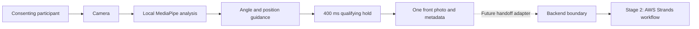

# Front-facing automatic capture — first-round specification

Version 1.3 · October 11, 2026 · Status: automatic capture integrated into the camera page; physical-camera acceptance pending

This is the active specification for the first advancement. It narrows the earlier multi-perspective design to one front-facing snapshot with live angle and position guidance. The project still has a second stage using AWS Strands; this document defines the capture output and integration boundary without implementing that stage.

The camera page defaults to automatic capture with live guidance and a single
Start action. After the unchanged angle and framing checks pass for 400 ms, it
saves one photo and stops the camera. The manual checkpoint is available at
`?mode=manual`. The reusable engine, guidance, reset diagnostics, and
`useAutoCapture` hook remain independent of presentation for later UI work.

## 1. Outcome and project boundary

A consenting participant starts the camera once. The application guides them into a front-facing, centered position and automatically saves one snapshot after the capture conditions hold for 400 milliseconds. A shutter click is not required. It then stops the camera, displays the captured result, and makes it available to a future integration layer.



| Area | First-round responsibility |
| --- | --- |
| Camera and local inference | Reuse the browser camera and locally hosted MediaPipe assets |
| Front angle and position | Evaluate live frames and publish actionable guidance |
| Automatic snapshot | Save the exact qualifying source frame once |
| UI integration | Connect the camera page to state, guidance, progress, actions, and a capture event; preserve the contract for later UI work |
| Strands handoff | Define the image/metadata contract and future adapter boundary |
| AWS Strands execution | Stage 2; owned by the downstream integration, outside this round |
| Left/right snapshots | Deferred; retain them as a possible later expansion |

The user's contribution ends at the selected camera frame snapshot. The architecture's downstream search, profile processing, graph construction, verification, and summarization remain outside this capture component.

## 2. Agreed angle and timing rules

| Measurement | Target | Accepted estimated range |
| --- | --- | --- |
| Yaw: turning left/right | 0° | −5° through +5° |
| Pitch: looking up/down | 0° | −5° through +5° |
| Roll: tilting toward a shoulder | 0° | −5° through +5° |
| Qualifying hold | 400 ms | All angle and position checks pass throughout observed samples |
| Result count | One | No further capture until explicitly restarted or retaken |

Use inclusive bounds and unrounded angles. The ±5° tolerance is the allowed difference between the estimate and its target, not a guarantee of physical measurement accuracy.

All three angles must pass simultaneously. A failing angle, lost face, failed position check, pause, source change, or excessive sample gap clears the current hold. Time starts at the first qualifying sample. Capture requires a new qualifying sample at least 400 ms later; a timer alone must never trigger the shutter.

## 3. Position checks and visual guide

These are the **initial framing settings under test**, separate from the adopted angle settings. They are centralized in `frontend/src/capture/types.ts`; changing them requires an explicit preset revision. They never adjust automatically.

Calculate a bounding box from the detected face-oval landmarks in normalized, unmirrored image coordinates. Normalize against the actual video image, excluding CSS borders and letterboxing.

| Check | Proposed initial requirement | Guidance when failing |
| --- | --- | --- |
| Face presence | Exactly one detected face | “Move your face into view” / “Keep one person in view” |
| Complete framing | Face-oval box stays within a 4% image-edge margin | “Keep your whole face inside the frame” |
| Apparent size | Face-oval height is 35–75% of image height | “Move closer” / “Move a little farther away” |
| Horizontal center | Box center is between 40% and 60% of image width | “Move your face toward the center of the outline” |
| Vertical center | Box center is between 40% and 60% of image height | “Move your face toward the center of the outline” |

These checks estimate face framing; they do not prove that every facial feature is visible. Pose detection is also not an identity or liveness check.

The camera page shows a centered oval as an alignment target. An initial oval height of 55% of the displayed image height, with width about 75% of its height, provides a visual target. The numeric checks above determine eligibility; the oval is guidance, not an additional hidden threshold. Compute its position within the displayed video image so portrait/landscape layouts and letterboxing do not move it off the actual target.

If the preview is mirrored, mirror only presentation. Measurements and saved images stay unmirrored. Screen arrows must account for preview mirroring; plain center instructions avoid confusing participant-left with screen-left.

## 4. Guided capture experience

1. Show the initial instruction: **“Face the camera at eye level. Center your face in the outline. The photo will be taken automatically.”**
2. The participant chooses **Start camera**. Wait for permission, video playback, and model readiness before arming automatic capture.
3. Present one primary corrective instruction at a time, with optional indicators for position, direction, and head tilt.
4. When all checks pass, show **“Hold this position…”** and progress from 0 to 100% over the qualifying hold.
5. Automatically save the qualifying frame, then show **“Front photo captured.”** with the preview.
6. Offer **Retake front photo**, download, and stop actions. Retake starts a new qualifying hold and preserves the old result until replacement succeeds.

| Condition | Primary instruction |
| --- | --- |
| Camera/model preparing | “Preparing camera…” |
| No face | “Move your face into view.” |
| Multiple detected faces | “Keep one person in view.” |
| Face too small | “Move closer to the camera.” |
| Face too large or clipped | “Move a little farther away and keep your whole face in view.” |
| Face off-center | “Center your face in the outline.” |
| Yaw outside ±5° | “Turn your face toward the camera.” |
| Chin too high | “Lower your chin slightly.” |
| Chin too low | “Raise your chin slightly.” |
| Roll outside ±5° | “Keep your head upright.” |
| Pose estimate unavailable | “Face the camera in clear, even lighting.” |
| All checks pass | “Hold this position…” |
| Processing cannot keep up | “Checking your position… keep the camera steady.” |
| Paused | “Capture paused.” with Resume |
| Saved | “Front photo captured.” |

Prioritize camera/face failures, then framing, then angles. Within framing, address clipping or excessive size before small size and centering. Within angles, address yaw, pitch, then roll. Expose all failing checks to the UI, while keeping one stable primary instruction. Updating text must never change the underlying gate results.

Use text as well as color. Announce significant instructions and successful capture through an appropriate live region; avoid announcing numerical angles on every frame. Optional debug angles may help testing but are not required in the final participant view.

## 5. Implementation approach

Use the existing React/TypeScript browser application. `useCamera.ts` retains ownership of camera permission, playback, device switching, and track cleanup. Configure this flow to prefer the user-facing camera, while honoring an explicitly selected camera.

Add a small, UI-independent capture engine with separate responsibilities for pose conversion, framing/gates, hold state, and output. Wrap it in `useAutoCapture` for React. Do not place capture timing or duplicate prevention in rendered component state.

Create a reusable local Face Landmarker in `VIDEO` mode with transformation matrices enabled, blendshapes disabled, and capacity for two faces so detected multiple-face frames can be rejected. Keep the current pinned SDK/model for initial testing. The confidence settings are separate from the angle tolerances.

MediaPipe's web inference is synchronous, and built-in smoothing is documented only for a one-face configuration. This two-face design must not assume smoothing. [MediaPipe web guide](https://developers.google.com/edge/mediapipe/solutions/vision/face_landmarker/web_js)

For this first round, use a rate-limited DOM-canvas processing path on the reference demo browser; measure responsiveness before introducing a second worker-based execution path. This intentionally defers part of the broader design's browser/worker scope. Keep the analyzer behind an interface so a worker can replace it without changing UI or capture rules. The camera page consumes the automatic hook by default; the manual checkpoint is available separately at `?mode=manual`. Browser tests mount the actual application, substituting only the detector for deterministic scenarios.

Proposed processing settings:

| Parameter | Starting value |
| --- | --- |
| Analysis rate | At most 10 distinct frames/second |
| Inference dimensions | Longest edge at most 640 px, aspect ratio preserved |
| Maximum gap between analyzed sample timestamps | 250 ms |
| Maximum age from frame sampling to qualification | 250 ms |
| Minimum qualifying samples | 3, spanning at least 400 ms |
| JPEG quality requested | 0.92 |
| Saved dimensions | Actual source frame dimensions |

These timing/performance settings need device testing. If they prevent progress, expose the limitation and revise them explicitly after measurement; never silently widen the angle tolerance.

## 6. Pose estimation and exact-frame capture

Read the transformation matrix for the single detected face. Validate its dimensions, finite values, scale, and rotation. Verify the flattened matrix layout against the pinned runtime, remove scale, and use one documented rotation convention to calculate yaw, pitch, and roll. Synthetic combined rotations and sign conventions are covered by tests. Directional guidance follows the canonical coordinate convention; physical front/up/down/tilted-pose validation remains a required camera trial before production acceptance. Do not set the participant's first observed pose to zero automatically.

Use unrounded per-frame angles to qualify capture. Smoothing may be applied to display values later, but must not allow an out-of-range frame to pass.

For each analyzed frame:

1. Confirm the page is visible, camera active, and source frame new.
2. Set a busy latch before any asynchronous work. Assign a frame ID, sequence, source generation, and monotonic sampling timestamp.
3. Freeze the full-resolution unmirrored frame onto a canvas.
4. Derive the smaller inference image from those frozen pixels; preserve the original.
5. Analyze sequentially, with increasing video timestamps. Reject obsolete, duplicated, or stale results.
6. Evaluate face count, framing, pose, and hold using sampled timestamps. At 10 Hz, a typical valid sequence at 0, 100, 200, 300, and 400 ms completes the hold.
7. Once the hold passes, reserve the single front result before awaiting JPEG encoding.
8. Encode the frozen original that supplied the qualifying result. Do not grab a newer frame from the live video.
9. Commit only if the session/generation is still active. Emit one capture event and stop inference.

A watchdog may clear stalled progress but cannot capture. Define display-stall timing from last result receipt; evaluate the qualifying hold from sample timestamps and enforce result age separately, avoiding accidental mixing of these clocks.

The result is angle- and framing-qualified. This round does not yet guarantee sharpness, good exposure, open eyes, or absence of occlusion. Record such failures in camera trials before choosing additional quality thresholds.

## 7. UI integration contract

The camera page and any later UI must receive the target and corrective information directly from the engine, without duplicating the measurement logic.

| State field | Purpose |
| --- | --- |
| `phase` | `idle`, `preparing`, `guiding`, `holding`, `capturing`, `complete`, `paused`, or `error` |
| `sessionId` | Current capture session identifier |
| `activeTarget` | Front view, target angles, and tolerances |
| `pose` / `angleError` | Current estimated angles and signed differences from the target, or null |
| `faceBox` / `framingChecks` | Normalized location, size, and pass/fail results |
| `guidanceCode` / `failedChecks` | Stable primary instruction code and complete failure list |
| `holdElapsedMs` / `holdProgress` | Qualified duration and progress; not confidence scores |
| `result` (React adapter) | Latest successfully committed image and metadata, if any |
| `diagnostics` / `troubleshooting` | Reset counters, bounded event history, blocked-check counts, and whether extra help is visible |
| `error` | Stable error code, readable message, and recovery capability |

Expose `start`, `pause`, `resume`, `retake`, `stop`, `retry`, and `dispose` actions, a state subscription, and `onCaptured(result)` / `onError(error)` events. The React adapter coordinates camera startup and model readiness for start/resume/retake/retry. Define stop as disarming capture and releasing the camera while preserving the committed result; dispose releases all engine resources. Retry recovers a failed camera/model/encoding operation and begins a fresh hold, without reusing old qualification evidence.

After success, stop camera tracks by default through their existing owner. Preserve the preview from the saved Blob. Retake restarts the camera if necessary and replaces the committed image only after a new successful capture.

The engine owns decisions and image Blobs. The UI owns presentation and its object URLs, revoking those URLs on replacement, deletion, or unmount. A capture event handler must not be able to cause duplicate engine commits by throwing an exception.

## 8. Stage 1 output and AWS Strands handoff

The full project has two stages. **Stage 1 captures a usable front image; Stage 2 receives that image for the AWS Strands workflow.** Keep the local engine independent of backend availability so a failed downstream request does not require taking another photograph.

Define a versioned, project-owned result contract. This is an application contract, not a built-in Strands API format:

```ts
interface FrontCaptureResult {
  image: Blob
  metadata: {
    schemaVersion: 1
    sessionId: string
    captureId: string
    frameId: string
    view: 'front'
    capturedAt: string // ISO 8601 time sampled by the application
    image: { mimeType: 'image/jpeg'; width: number; height: number }
    poseDegrees: { yaw: number; pitch: number; roll: number }
    targetDegrees: { yaw: 0; pitch: 0; roll: 0 }
    toleranceDegrees: { yaw: 5; pitch: 5; roll: 5 }
    qualification: {
      holdMs: number
      sampleCount: number
      faceCount: 1
      framingPassed: true
    }
    diagnostics: Diagnostics // local reset counts, blocked counts, latest 50 reset events
    presetVersion: string
    modelVersion: string // resolve to the model checksum/build identifier
    sdkVersion: string
  }
}
```

The output photo contains the original full frame without UI graphics or mirroring. Raw landmarks and matrices may be retained in a separate local diagnostic report; the downstream contract initially needs the image and summary metadata. Do not label pose qualification as an identity match or a probability of correctness.

The future handoff adapter will:

1. Subscribe to the successfully committed capture event.
2. Send the actual JPEG bytes and JSON metadata through an authenticated backend interface. A proposed transport is an HTTP multipart request with `image` and `metadata` parts; the endpoint and limits must be agreed with the Stage 2 owner.
3. Correlate the request with `captureId`. Have the backend enforce deduplication within the authenticated user's/session's scope so retries do not create duplicate agent jobs. A retake receives a new capture ID.
4. Validate the file and metadata on the backend before creating a Strands job. Browser metadata is useful context, not authoritative proof.
5. Adapt the received image to the downstream model/tool workflow. Strands documents image-plus-text inputs, but actual image handling depends on the selected model and tools. [Strands multimodal prompting](https://strandsagents.com/docs/user-guide/sdk/agents/prompts/)
6. Return a backend job ID associated with the capture ID and expose downstream job status independently of capture state.

Do not pass a browser `blob:` preview URL as the image location: the backend cannot use that page-local reference. Do not embed AWS service credentials in the frontend. Direct multipart upload versus presigned object-storage upload remains a Stage 2 transport decision; neither is required to finish the first-round capture feature.

The future UI should distinguish **Photo captured**, **Sending**, **Processing**, **Complete**, and **Transfer/processing failed**. The latter four are adapter/job states, not reasons to restart the camera. A failed transfer retries the same captured file. If a retake supersedes a photo, responses for the old capture ID must not replace the currently selected result.

This specification creates no live upload, AWS resource, agent invocation, or downstream processing implementation. Whether the integrated product dispatches immediately after capture or at a later workflow action belongs to the Stage 2 orchestration; automatic photo capture itself must not depend on that choice.

## 9. Failure and cancellation rules

- Camera permission or model loading failure: show an actionable error, do not arm, and provide retry.
- No/multiple faces, bad angle, or bad framing: continue guidance and clear the hold.
- Camera stops, changes, disconnects, or page becomes hidden: invalidate pending capture and clear the hold. Require an explicit resume/start after recovery.
- Slow or stale inference: reject its qualification evidence and show processing feedback; never capture based on elapsed wall time alone.
- Encoding failure: preserve the previous committed photo if present and require a fresh hold after retry.
- Stop, pause, retake, or unmount during asynchronous work: use session/generation and operation IDs so late callbacks cannot publish photos, unlock newer work, or restore deleted state.
- Save success: commit once before notifying subscribers; stop automatic processing.
- Later upload/Strands failure: preserve the local photo and separate downstream error handling from capture recovery.

Keep only the current candidate and committed result, plus the old result temporarily during retake. Clean up media tracks, detector resources, timers, subscriptions, transferables where applicable, and object URLs through their owners.

## 10. Implementation sequence and acceptance

| Step | Deliverable | Required verification |
| --- | --- | --- |
| 1 | Pose adapter and front/framing gates | Angles, signs, scale/layout, boundaries, invalid matrix handling |
| 2 | Hold and one-shot capture engine | 400 ms qualification, resets, stale/duplicate samples, no duplicate captures |
| 3 | Live source and frozen-frame encoding | Saved frame matches the analyzed frame, including delayed processing |
| 4 | React adapter and minimal guided view | Position/angle prompts, hold progress, stop, recovery, explicit retake |
| 5 | Output contract and mock downstream consumer | Valid JPEG/metadata, one capture event, reusable result after simulated downstream failure |
| 6 | Reference-browser and physical-camera trial | One Start produces one front photo without shutter clicks; report observed usability and remaining limits |

Acceptance scenarios include no face, two faces, too close/far, off-center, turned head, raised/lowered chin, tilted head, a valid 400 ms hold, interruption immediately before saving, and retake success/failure. Verify mirrored/unmirrored presentation and different video aspect ratios. Use deterministic tests for timing and a fake detector for UI states, with separate real-model/browser checks.

Run existing frontend build/lint and relevant camera regression checks after implementation. Test a consenting participant on the actual demo camera and browser before claiming that the ±5° rules are usable. Record angle jitter, hold resets, capture latency, output clarity, and framing failures. Broader browser support, worker execution, more perspectives, and additional image-quality gates can follow after this front-only flow is demonstrated.

## 11. Reset records and troubleshooting

Keep the agreed ±5° tolerances and 400 ms hold unchanged. Additional guidance never widens the acceptance window or permits a manual override in automatic mode.

- Record a reset **only when a qualifying hold actually existed**. Repeated bad frames while guiding are blocked checks, not new resets.
- Each event contains elapsed session milliseconds, source frame ID, all failure reasons, last qualified hold duration, and qualifying sample count. Record framing/angle failures, lost/multiple faces, invalid estimates, stale results, sample gaps, pause, hidden page, camera changes/disconnects, stop, and processing/encoding failures.
- Keep cumulative per-reason counts and the newest 50 events. A single event can have multiple reasons, so reason counts may exceed total resets. Keep only aggregate blocked-check counts for other rejected samples. The log contains no image pixels or landmarks.
- Show troubleshooting after **three failed qualifying holds in the session**, or **10 seconds of active guidance without capture**, whichever comes first. Intentional interruptions (pause, hidden page, stop, camera change/loss) are recorded but do not count toward the three-failure trigger. Paused/model-loading time does not advance the 10-second trigger; resuming starts that timer afresh.
- Keep help visible for the rest of the unsuccessful session. Select the main tip from the most frequent blocked check; include lighting/visibility, distance/centering, head alignment, and processing-speed guidance as applicable.
- Pause/resume, camera switching, and retry preserve diagnostics. A new Start after Stop or an explicit retake creates a fresh session. Download the previous session log before beginning a new one if needed.
- The camera page exposes **Capture diagnostics** and **Download reset log** even if no photo is captured. Successful output metadata includes a copy of that session’s diagnostics. A downstream adapter may omit diagnostic details from its payload if Stage 2 does not need them.

## 12. Implementation map and validation

- `frontend/src/capture/types.ts`: fixed preset, public state, frame and result contracts.
- `pose.ts` / `gates.ts`: column-major matrix conversion, angle and face-oval framing checks.
- `engine.ts`: hold evidence, cancellation generations, reset log, one-shot commit, callbacks.
- `browserSource.ts`: distinct video-frame scheduling, local VIDEO detector, frozen full-resolution canvas, reduced inference canvas, JPEG encoding.
- `guidance.ts`: UI text and troubleshooting selection.
- `frontend/src/hooks/useAutoCapture.ts`: camera/model lifecycle and capture actions; `onCaptured(result)` is the future backend adapter boundary.
- `frontend/src/App.tsx` / `CameraCapture.tsx`: default automatic capture, guidance, progress, diagnostics, and saved photo/metadata downloads.
- `frontend/src/ManualCapture.tsx`: separate manual checkpoint at `?mode=manual`.
- `frontend/tests/auto-ui/vite.config.ts`: actual application with a detector substitution for deterministic tests, or real local MediaPipe for model checks.

Run `npm run test:unit`, `npm run test:auto-ui`, `npm run test:auto-real -- --project=chrome`, `npm test -- --project=chrome`, `npm run build`, and `npm run lint` from `frontend/`. Run the two automatic browser suites sequentially because they share a bundle/port. Both mount the **actual application**: the first uses a simulated detector, the second the real MediaPipe SDK. The separate production-browser suite exercises the manual checkpoint. No detector substitution is included in normal application builds. The optional personal-photo checkpoint is skipped unless explicitly supplied.

Automated tests establish timing, rejection, cancellation, UI flow, and output behavior. They do not establish real-camera angle accuracy, demographic robustness, image sharpness, or whether participants can comfortably satisfy the unchanged limits. Test a consenting participant on the intended device before accepting those usability claims. Main-thread inference, broader mobile testing, and physical directional-guidance validation remain known limits.
