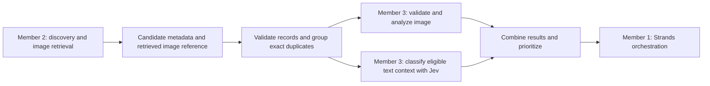

# Member 3: review and implementation plan

Created October 10, 2026 · Updated October 11, 2026 · Status: Stages A and B implemented with automated verification. Real-photo acceptance/calibration and a successful live Jev call remain pending.

This plan reviews `FaceTrace_Member_3_Tasks.md` supplied from Downloads against the current repository. It does not replace the active [front-capture specification](front-capture-spec.md). The candidate-processing module is a separate addition to the completed capture component. The user authorized Stage B after the combined Stage A checkpoint. The [Stage B guide](member-3-stage-b.md) contains the current usage, acceptance status and commit instructions. Keep implementation compact: three Stage B modules share the existing contracts and Stage A results.

Step 1 also uses the supplied `message.md` project pitch. The pitch specifies Python/FastAPI with AWS Strands, contextual Jev filtering after conventional deduplication/validation, and independent source-risk assessment. The [version 1 contract](../contracts/README.md) now specifies payload fields and implementation defaults for transport/storage. Teammate acceptance remains an integration checkpoint. The wider project roadmap is not authorization to implement discovery, threat intelligence or facial-matching research in this module.

The first milestone is an agreed candidate contract and one candidate processed through a callable backend function with image analysis, Jev classification, and a predictable JSON result. Build that path before adding optional image-quality heuristics.

## Scope and ownership



Image validation and conventional deduplication precede the relevant expensive work. Image-analysis and context-classification outcomes remain independent: an unusable image does not erase useful page context, and contextual relevance does not establish who appears in a photograph. See the proposed eligibility and deduplication rules below.

- Member 3 owns image validation, local face detection/preprocessing, contextual classification, prioritization, and a callable module.
- Member 2 owns discovery, external image downloads, and source metadata. Member 3 records upstream retrieval failures rather than implementing a second downloader.
- Member 1 owns the agent, workflow registration, deployment, storage integration, and user-facing orchestration.
- Member 4 owns URL/domain reputation queries. Source category means the kind of page, not its trustworthiness.
- The existing camera flow keeps its front-only target, ±5° per axis, 400 ms hold, reset diagnostics, and explicit retake. Its JPEG and metadata remain a separate capture contract. Physical-camera acceptance is still pending.
- Candidate analysis does not compare faces, generate identity embeddings, or assign identity probabilities. Multiple-face crops remain unassigned to the subject.

## Repository audit: IMG-01

These audit findings came from source inspection during the initial review. Section 1 adds separate contract checks; it does not change the existing capture/checkpoint implementation.

| Existing component | Reusable behavior | Boundary or missing work |
| --- | --- | --- |
| `frontend/src/capture/browserSource.ts` | Freezes an unmirrored source frame, resizes a separate inference canvas, runs MediaPipe, encodes the qualifying original as JPEG | Browser DOM/canvas and VIDEO-mode inference; not a backend image processor |
| `frontend/src/capture/types.ts` | Versioned `FrontCaptureResult` with JPEG Blob, dimensions, pose and diagnostics | Blob is page-local; backend transport must carry bytes or a backend-resolvable asset reference |
| `frontend/src/hooks/useAutoCapture.ts` | `onCaptured(result)` integration hook; manages camera/model lifecycle | No upload or Strands execution |
| `frontend/src/faceAnalysis.ts` | Reusable `PhotoAnalyzer` in IMAGE mode; dimensions, landmarks, matrices, overlay | Uses DOM image decoding/canvas; no OpenCV; maximum two detected faces |
| `face_landmarker.py` | `create_face_landmarker()` creates a reusable local CPU IMAGE-mode detector | Maximum two faces; caller owns lifecycle and sequential access |
| `photo_checkpoint.py` | `decode_image()`, BGR-to-RGB preparation in `analyze_image()`, non-destructive landmark overlay and JSON reporting | Decoder has no explicit compressed-byte, dimension, pixel, time, or memory limits; not ready as an untrusted-input boundary |
| `tests/test_photo_checkpoint.py` | Empty/corrupt input, RGB conversion, original preservation, real-model no-face fixture | Candidate resource limits, crops, quality, classification and integration need new coverage |

**Correction to the supplied task:** MediaPipe is implemented in JavaScript and Python; OpenCV is used by the Python checkpoint, not the browser application. No Jev client or candidate-processing service was found in the inspected source.

JPEG export already exists, alongside downloadable JSON metadata. Existing color conversion and detector lifecycle are useful reuse points. Refactor shared internals only when needed, preserving checkpoint behavior and its tests; do not copy the entire checkpoint into a new module or expose its unrestricted decoder directly to candidate uploads.

## Execution boundary and language

**Planning baseline from the pitch: Python/FastAPI backend with AWS Strands.** Implement Member 3 as a Python package callable inside that backend. It can reuse this repository's OpenCV/MediaPipe code; no separate Member 3 HTTP service is needed for the proposed POC.

| Boundary | Proposed integration |
| --- | --- |
| Browser → Member 1 | FastAPI accepts the captured JPEG/metadata and caller-supplied subject identifiers; Member 1 owns the endpoint and job lifecycle |
| Member 2 → Member 3 | In-process candidate records plus a backend-owned resolver for retrieved image assets |
| Member 3 → Member 1 | Python function returns a JSON-serializable result; thin Strands tool wrapper adapts it to the orchestrator |
| Backend → browser | Member 1 combines contextual findings with separately computed source-risk results and returns the report |

The task file's TypeScript folder layout is superseded by the pitch's Python backend choice. Section 1 documents local storage and synchronous HTTP adapter defaults in the [contract guide](../contracts/README.md). They will be implemented in later sections. Member 1 retains production deployment, authentication and investigation/job lifecycle ownership.

Strands supports ordinary functions exposed as tools in both Python and TypeScript. The proposed module needs a thin adapter, not its own agent. [Official Strands custom-tool guide](https://strandsagents.com/docs/user-guide/sdk/tools/custom-tools/)

## Jev findings and integration design: AI-01–AI-04

Official documentation checked on October 10, 2026:

| Language | Verified package and entry point | Reference |
| --- | --- | --- |
| Python | `typesafe-sdk`; `TypeSafeClient` / `AsyncTypeSafeClient`; `system_one()`; key from `TYPESAFE_API_KEY` | [Python SDK](https://docs.typesafe.ai/sdk/python) |
| JavaScript/TypeScript | `@typesafe-ai/sdk`; `TypeSafeClient`; `systemOne()`; Node.js 20+ | [JavaScript SDK](https://docs.typesafe.ai/sdk/javascript) |

The documented HTTP endpoint is `POST https://api.typesafe.ai/v1/systemone`. Requests supply state and typed questions. Choice selects a predefined option; Noul and Score offer other constrained decisions. The documented answer schema does not include a free-form explanation field. [Official API reference](https://docs.typesafe.ai/api)

The application will build its own result contract around that API:

1. Send bounded subject identifiers and page metadata as structured text context. Image pixels, crops, raw landmarks, secrets, and signed asset URLs are not needed by this classifier.
2. Use a Choice question with explicit criteria for `high`, `medium`, `low`, and `unknown`. Question instructions describe the decision completely; object keys alone must not carry the rubric.
3. Add a separate Choice for `professional_profile`, `social_media`, `news_article`, `personal_website`, `forum`, or `unknown` when AI-03 is implemented.
4. Build readable reasons from explicit evidence records. Exact text/username comparisons can be deterministic; semantic context checks can use additional constrained questions. Label model-assessed evidence as such. Content-based reasons reference actual supplied fields and excerpts; missing-data and operational reasons reference the missing field or failure status without fabricating an excerpt. These are application explanations, not Jev's hidden reasoning.
5. Validate required answer keys, answer types and allowed values at runtime. Unexpected responses yield `unknown`, a review flag, and an error record.
6. Keep credentials server-side. Confirm and pin the installed SDK version when implementing; record the returned model identifier and the application's rubric version for each classification.
7. Configure one bounded retry policy and a total deadline, accounting for SDK retries. Do not stack independent SDK and application retries. Authentication or request-validation failures need correction, not repeated calls.

The official SDKs have default retry behavior, but this plan does not assume its timing satisfies the application budget. Exact timeout/retry configuration must be checked against the selected SDK release during implementation. [SDK overview](https://docs.typesafe.ai/sdk)

**Documentation verification and pinned SDK installation are complete. No `TYPESAFE_API_KEY` is configured in the checked environment, and a successful live classification is not verified.** Use synthetic text for the first live smoke test. Offline mocks must be labeled as mocks.

### Proposed relevance rubric

These are application rules to evaluate, not model guarantees.

| Label | Meaning |
| --- | --- |
| `high` | Identifier evidence plus independent, relevant contextual support; no material conflicting evidence |
| `medium` | Some contextual support, but meaningful gaps or ambiguity remain |
| `low` | Available context is unrelated or materially conflicts with the supplied context |
| `unknown` | Insufficient information, name-only association, unresolved conflicting signals, missing credentials, provider failure, or invalid response |

A name match alone cannot become `high`. A matching username is contextual evidence, not identity proof. Record contradictory evidence as well as supporting evidence. Treat page text as untrusted data: embedded requests to change labels, reveal credentials, or perform actions have no authority.

For the first version, retain a result record for every accepted candidate ID. Provide a stable relevance ordering (`high`, `medium`, `low`, `unknown`) over canonical eligible results and an independent review list. The frontend can show that shorter list while duplicate, invalid and uncertain records remain inspectable. Preserve input order for ties. No confidence-based evidence deletion is planned.

Set `reviewRequired` for `medium`/`unknown` relevance, contradictory evidence, failed or unavailable stages, zero/multiple detected faces, detector-capacity limits, or quality concerns. A `high` label does not clear image or operational review flags. If source/quality checks are deferred, explicitly flag those checks as not assessed.

## Version 1 contract: INT-01

Runtime models in `candidate_processing/contracts.py` export versioned JSON Schemas for Members 1 and 2. The types in the supplied task are internal application types, not native Jev SDK types. Section 1 implements the [contract and synthetic fixtures](../contracts/README.md); teammate acceptance has not been claimed. The remaining processing behavior below is planned.

### End-to-end handoff from the pitch

| Handoff | Information passed | Status |
| --- | --- | --- |
| Browser → FastAPI | Reference JPEG, existing capture metadata, and a subject name or known username | Required by pitch; exact endpoint and multipart/asset transport are not specified |
| Strands → Member 2 | Subject identifiers and investigation context; any reference-image use depends on the selected discovery provider | Workflow direction established; provider request format belongs to Members 1/2 |
| Member 2 → Member 3 | Candidate IDs, original image/source URLs, retrieved-image references or retrieval errors, and page/profile metadata | Fields implemented in Section 1; byte storage and retrieval remain later sections |
| Member 3 → Strands | Preserved candidate records, deduplication disposition, image analysis, contextual ranking and supporting evidence | Proposed module result; contains no threat verdict or facial-identity verdict |
| Member 4 → Strands | Independent URL/domain risk assessment | Separate ownership; risk must not alter Member 3's contextual relevance label |

The reference camera image and discovered candidate images have different roles. Member 3's initial candidate classifier uses the caller's identifiers and discovered page context, with no comparison against the reference face. An optional capture identifier can correlate the investigation without copying the reference JPEG into each candidate or sending it to Jev.

### Input

A batch contains `schemaVersion: 1`, `requestId`, optional `captureId`, and `candidates`. Each candidate keeps the originally proposed `id`, `imageUrl`, `sourceUrl`, optional `pageTitle`/`description`, and `subject` fields. To support the pitch's name-or-identifier input, make `subject.name` optional and require at least one nonblank name or username; `subject.context` remains optional. Context alone is not sufficient. Add these fields:

| Field | Purpose |
| --- | --- |
| `sourceId` | Stable upstream source identifier, if different from the candidate ID |
| `image.status` | `available`, `failed`, or `unavailable` |
| `image.assetId` | Required when available; opaque reference to Member 2's retrieved original |
| `image.error` | Structured retrieval failure supplied by Member 2 when applicable |
| `profileMetadata` | Optional allowlisted text fields such as displayed username, organization, role and biography |

The `imageUrl` is provenance, not an instruction to fetch it. A backend-injected asset resolver will provide bounded image bytes from the caller's authorized asset set; candidate input cannot select arbitrary network endpoints or filesystem paths. Hashes are computed from stored bytes and reported in `imageAnalysis.contentSha256`, not accepted from caller input. For local integration tests, the resolver can use an in-memory fixture map. Member 1/2 supply the production storage binding.

Subject identifiers come from the caller. No subject identifiers are inferred from the captured face. Keep the original field values for provenance, and define normalization explicitly before comparing names or usernames.

### Output

Return `schemaVersion`, `requestId`, optional echoed `captureId`, one result per validly identified input candidate, `rankedCandidateIds`, and `reviewCandidateIds`. The ranked list contains canonical eligible results; the complete result list retains all provenance. Reject malformed batch structure or duplicate IDs explicitly before processing; repeated content under distinct IDs is a deduplication case, not a schema error.

| Result field | Proposed shape and semantics |
| --- | --- |
| Provenance | Echo `id`, `sourceId`, `imageUrl`, `sourceUrl`, and original `assetId` when present |
| Disposition | `candidate`, `duplicate`, or `invalid`, with reason codes and `duplicateOf` when applicable; processing failures are retained candidates, not invalid evidence |
| `imageAnalysis.status` | `ok`, `invalid`, `unavailable`, or `error` |
| `imageAnalysis.valid` | `true` after successful validation, `false` for established invalid input, `null` if not established |
| Image measurements | MIME type, width, height, and byte length; use `null` where unavailable |
| Face result | `faceCount: number \| null`, `maxFaces`, `atDetectorLimit`, and crop references |
| Quality | `good`, `poor`, or `unknown`, with measurements and flags; omitted checks cannot imply good quality |
| `classification.status` | `ok`, `skipped`, or `error`, independent of image status |
| Context decision | Constrained `relevance` and `sourceType`; absent/failed decisions become `unknown` |
| Evidence | Reason code, input field path, bounded excerpt when available, and method (`rule` or `model`); operational reasons reference status/error records |
| Review | Top-level `reviewRequired` and reason codes combining image and classification concerns |
| Errors | Stage, stable code, bounded message, and retryability; no credentials or image bytes |
| Versions | Schema, pipeline, model, detector/SDK, and rubric versions when applicable |

Use `faceCount: 0` only when inference succeeded and detected no faces. A model failure is `null`, not zero. `atDetectorLimit` means the configured capacity was reached, not that the true total is known. Preserve the current two-face limit for the initial adapter and report it explicitly.

A missing image can coexist with a successful contextual classification. Failed Jev calls can coexist with successful image analysis. Both cases retain the candidate and require review. Face-free or low-quality images do not justify removing page evidence.

### Conventional validation and deduplication before Jev

The pitch calls for duplicate images and invalid results to be filtered before classification. Proposed interpretation for the handoff:

1. Validate the complete batch, including identity and required provenance fields. Reject malformed payloads before processing. Retain operational failures encountered after acceptance as per-candidate results with explicit reasons.
2. Validate available image bytes and compute/verify exact-byte hashes before image analysis. Reuse image analysis for identical bytes while preserving every original image/source reference. Similar-looking photographs are not exact duplicates.
3. Collapse repeated candidate records only when subject, source page, image content and classification-relevant metadata are equivalent. Reuse the classification, link duplicate records to the canonical candidate and return one canonical ID in the ranked list.
4. The same image on different source pages remains separate contextual evidence. Each page can have different relevance and risk; an image hash alone must not merge those page findings. Changed metadata also requires its own classification.
5. A failed image with adequate page context can still receive text classification. Missing context yields `unknown` with `status: skipped` and a review reason. Do not call a missing/uncertain record irrelevant merely to shorten the list.
6. Give the frontend a compact canonical list plus access to duplicates, invalid records and review items. Record every exclusion from the default list so it can be audited.

This resolves the pitch's shortened-results goal while preserving the task file's uncertain-evidence requirement. Members 1/2/3 still need to accept these exact deduplication and eligibility semantics.

## Image-processing design: IMG-02–IMG-04

Proposed initial limits below apply only to the new module. Confirm them against Member 2's samples and Member 1's runtime; they do not change capture settings.

| Limit | Starting proposal |
| --- | --- |
| Formats | Still JPEG and PNG, verified from content |
| Compressed size | 10 MiB per candidate |
| Decoded dimensions | At most 20 million pixels and 10,000 px on either side |
| Batch size | At most 20 candidates |
| Vision concurrency | One image at a time per detector instance |
| Crop output | Up to two padded, clipped, aspect-preserving 256 × 256 crops with original-image bounding boxes |
| Jev budget | 10 seconds total per candidate, including at most one retry; enforce a separate batch deadline agreed with Member 1 |

Decode only after bounded input reads and header checks. The implemented worker uses Pillow for verification/full decoding, rechecks dimensions, enforces CPU/time limits, and receives no provider credentials from the parent environment. RSS monitoring applies on macOS; Linux also has an address-space cap. This subprocess is not an OS network/filesystem sandbox, and macOS memory sampling can overshoot. The production host must supply hard memory and OS access restrictions before arbitrary uploads. See the [Stage A guide](member-3-stage-a.md) for tested limits and platform caveats.

Normalize EXIF orientation consistently before inference and report dimensions/boxes in that normalized coordinate space. Handle grayscale and transparency explicitly. Keep the original immutable; crops have separate asset IDs and omit unnecessary metadata. Do not write photos into version control or return arrays of raw pixels in JSON.

The implementation reuses the existing color conversion and IMAGE-mode detector inside a disposable worker, serialized per analyzer. Each image starts a fresh process/model instance. A decode error, worker crash, or inference failure creates a per-candidate error result; a later candidate can still run.

Stage A collects grayscale exposure and Laplacian-variance blur measurements on the inference image. Provisional thresholds are exercised with synthetic extreme cases and documented for real-photo calibration; they are not universal cutoffs. Landmark proximity to an image edge flags possible clipping, without proving occlusion or full facial visibility. Heuristic concerns yield `quality: poor` as a review flag; otherwise quality remains `unknown` with an explicit uncalibrated-threshold flag. No candidate is discarded and no `good` quality claim is made before calibration.

## Build order and verification checkpoints

Stage A was implemented as one combined checkpoint. Stage B now has its own [review and commit instructions](member-3-stage-b.md#review-and-commit). This original table remains the requirement-to-milestone reference; the active stage guides describe delivered behavior and outstanding acceptance.

| Order | Tasks | Deliverable | Verification before advancing |
| --- | --- | --- | --- |
| 1 | IMG-01, INT-01 | Use the pitch's Python/FastAPI baseline; agree image handoff, deduplication and JSON Schema; write shared fixtures | Members 1/2 can consume the same example; username-only subjects, duplicate IDs/content, missing fields and unavailable images have defined outcomes |
| 2 | AI-01 | Server-only Jev adapter, fake client, one synthetic live smoke case | Real response validates; missing key, timeout, rate limit and malformed output retain an unknown/review result |
| 3 | IMG-02, IMG-03, AI-02, INT-04 | One callable end-to-end path using bounded image processing and contextual classification | One candidate returns measurements, provenance and a decision; image/provider failure paths remain independent; direct call needs no agent |
| 4 | AI-04, INT-02 | Batch processing, conventional deduplication, stable ordering, complete failure coverage | One retained result per accepted input ID; repeated images across different pages preserve each page's context; same-name/different-person and multi-face cases cannot imply identity verification |
| 5 | INT-04 | Thin adapter for Member 1's selected Strands runtime | Wrapper validates inputs and serializes outputs; Member 1 invokes it in their workflow and confirms the schema |
| 6 | INT-03 | Small labeled evaluation and written findings | Precision/recall, confusion counts, review rate, latency and false exclusions reported with dataset size and model/rubric versions |
| 7 | AI-03, IMG-04 | Source categories and evaluated quality flags | Source `unknown` remains supported; poor quality stays reviewable; run affected tests and evaluation again |

Source categories and quality heuristics can be deferred for a demo, with `unknown` returned explicitly. They remain required to finish the full supplied checklist. Mocked Jev calls enable development but do not satisfy the live integration criterion.

Current compact implementation and remaining integration boundaries:

```text
contracts/                         # JSON Schemas and cross-language examples
candidate_processing/
  contracts.py                     # Runtime validation and serialization
  image_worker.py                  # Resource-bounded decode/detection lifecycle
  image_analysis.py                # Validation, preprocessing, crops, quality
  jev_client.py                    # Provider adapter and bounded failure handling
  classification.py                # Rubric, evidence, result validation
  stage_b.py                       # Record deduplication, ordering, review and live smoke command
tests/member3/                     # Contract, image, classifier, integration tests
```

Stage C will add the combined orchestrator (including shared image analysis and an overall deadline), the thin Strands/HTTP adapters, and labeled evaluation only as needed. Dependencies such as asset resolution, detector access, crop storage and Jev calls are injected. This keeps offline tests independent of credentials, downloads, cameras and AWS execution.

## Test and evaluation plan

| Area | Required cases |
| --- | --- |
| Image validation | JPEG/PNG; empty, corrupt and truncated input; misleading extension/MIME; compressed-size and decoded-pixel limits; unsupported animation; orientation/grayscale/transparency; worker timeout/crash |
| Vision | No face, one face, two faces, detector capacity reached, boundary crop; original preservation; failure followed by a successful candidate |
| Classification | Missing metadata, name-only match, same name with conflicting context, username-only evidence, corroborating context, contradictory evidence, page-embedded instructions |
| Provider | Valid mocked response; unknown enum; missing/wrong answer type; timeout; exhausted retry; authentication failure; cancellation; explicitly enabled synthetic live smoke test |
| Batch/adapter | Name-only/username-only subject inputs; empty batch, duplicate IDs, bad schema, all failures, mixed failures, stable ties, no lost source references, JSON round-trip, batch deadline with explicit outcomes for unfinished items |
| Deduplication | Exact repeated records; identical image on different pages; changed page metadata; URL with changed bytes; unverifiable hash; canonical result failure; retained provenance and review access |

Use synthetic images for codec/resource tests and fake detectors for deterministic counts/crops. Verify real detection separately using authorized fixtures with known expected cases. Existing tests cover the checkpoint, not the new service; passing them alone is insufficient. Re-run existing Python tests after shared preprocessing changes. Run frontend regressions only if frontend files change.

Propose 40 manually labeled text-context cases, including at least 10 name collisions and 10 sparse/ambiguous cases. Allocate 24 for rubric development and freeze 16 as a held-out evaluation; avoid subject/page duplicates across the split. Treat this as a small demo evaluation, not evidence of broad population accuracy.

Before labeling, define relevance independently of identity: for binary relevance metrics, `high`/`medium` are positive and `low` is negative; `unknown` is abstention. On cases with a determinate human label, report abstentions separately and count abstained relevant cases as missed positives in end-to-end recall so selective review cannot inflate recall. Report a four-label confusion table, per-label counts, review coverage of ambiguous cases, and relevant cases incorrectly assigned `low`.

Because this plan retains every candidate record, permanent evidence deletion should be zero. Measure removal from the default ranked list separately: duplicate grouping and invalid-result eligibility can still incorrectly hide a relevant finding. Also report simulated false exclusions if a downstream consumer were to suppress `low`, and inspect low-ranked relevant results. Record latency and provider errors independently of relevance quality. Thresholds and acceptance targets should be agreed before inspecting held-out results; no accuracy claim is made in advance.

## Remaining integration coordination

Local defaults are documented in the [contract guide](../contracts/README.md). These remaining coordination items do not block the contract section. No messages have been sent to teammates.

| Owner | Decision needed | Proposed default |
| --- | --- | --- |
| Member 1 | Runtime/deployment details and callable signature | Python/FastAPI with Strands is specified by the pitch; use a Python import plus thin tool wrapper |
| Members 1/2 | Image byte/asset handoff, source IDs, batch size and deadline | Retrieved asset references; Member 2 retains download ownership |
| Member 1 | Storage binding and crop retention | Caller-owned resolver/store; return references, not embedded pixels |
| User/team | Jev account access and server-side key configuration | Official TypeSafe SDK/API; synthetic first live call |
| Members 1/2/3 | Shared schema, deduplication and review semantics | One preserved record per candidate; canonical ranked list; independent image/classification statuses |
| Member 1 | Runtime worker memory/time isolation | Bounded worker before untrusted image ingestion |
| User/team | Available build time and demo versus full-checklist target | Complete the first end-to-end path, then defer AI-03/IMG-04 only if needed |

The task file's two-week schedule is an example, not an agreed deadline. After these decisions, estimate against the actual integration environment and fixture availability.

## Completion criteria

The full module is complete when agreed-schema candidates flow from Member 2 through validated image processing and a verified live Jev adapter into Member 1's callable integration; provenance and uncertain results survive all failure paths; image quality/source categories meet their acceptance checks; and automated tests plus a labeled evaluation are documented.

The shared contract, [private asset storage](member-3-storage.md), [Stage A image processing](member-3-stage-a.md) and [Stage B classification/prioritization](member-3-stage-b.md) are implemented. Automated checks cover SDK mock transport, contextual policy, stable ranking, record deduplication and the Stage A/B handoff, alongside existing regressions. No live Jev response is verified because credentials are not configured. Quality calibration, real-photo acceptance, the combined orchestrator, HTTP/Strands adapters and labeled evaluation remain outstanding. Active capture requirements and the original task files are unchanged. The existing camera acceptance trial remains a separate outstanding task.
