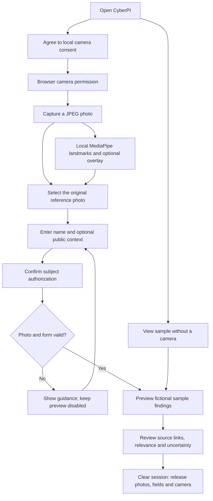
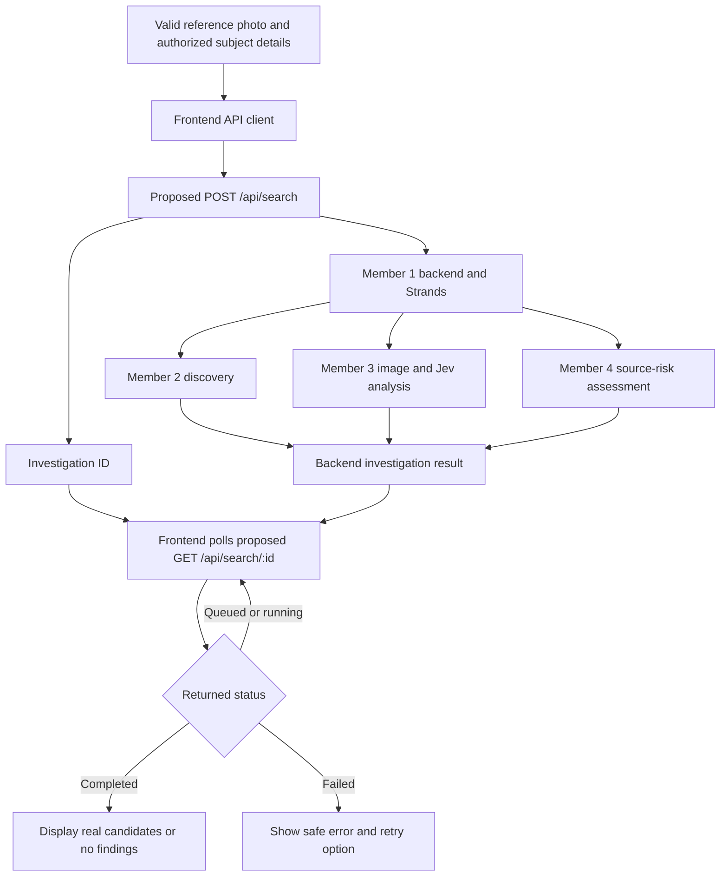

# CyberPI: step-by-step frontend walkthrough

The product name is **CyberPI**. The shared brief calls it FaceTrace, but Adeeba confirmed that the application should keep its existing name. Member 1's backend is not ready, so the current UI uses clearly labeled fictional fixtures.

## 1. What your role covers

You own what the person sees and interacts with: camera controls, reference-photo selection, subject details, authorization, submission/progress UI and source-linked findings. You also own the future browser-to-backend adapter. You do not need to write the crawler, Strands agent, Jev classifier or threat-intelligence decisions.

| Owner | Responsibility |
| --- | --- |
| You, Member 5 | Browser UI and API connection |
| Member 1 | Application backend and Strands orchestration |
| Member 2 | Candidate image/page discovery |
| Member 3 | Candidate analysis and Jev contextual relevance |
| Member 4 | Source-risk assessment |

## 2. What is working now

This flow **does not search the internet**. The form validates the selected photo and details, then displays a static sample. Those findings are unrelated to the captured person. MediaPipe is used for local face landmarks, not identity verification. Its analysis can fail without losing the original photo.

## 3. What I built, in order

1. **Audited the existing app (FE-01).** Located React/TypeScript/Vite, the camera hook, JPEG capture, tab-memory storage, MediaPipe analysis and cleanup. OpenCV belongs to separate Python tooling; no new browser image-processing pipeline was added.
2. **Prepared the API proposal (FE-04).** Defined TypeScript types, validation, a multipart payload builder and a response parser. An API contract is the agreed shape of requests and replies. This one remains a proposal until Member 1 confirms it.
3. **Added subject details (FE-02).** Required name, optional username/public context, and explicit subject authorization. No extra personal fields or accounts.
4. **Connected the selected reference to validation.** A missing photo/name/authorization keeps preview disabled. The draft permits JPEG/PNG images up to 5 MiB. These are frontend limits to confirm with Member 1.
5. **Built candidate cards (FE-07).** Each displays a thumbnail or fallback, title, hostname, source link, relevance, explanation and review label. The panel explains that contextual relevance is not identity verification. Missing source risk is “not assessed”; unknown is not low risk.
6. **Added sample outcomes.** Multiple, single, empty, partial, missing metadata, queued, running and failed. A fixture is just predictable fake data for developing and checking a UI. It is never presented as a live search.
7. **Checked the implementation.** Production build and seven contract unit tests pass. Browser checks covered desktop/mobile layout, form validation, camera capture with a synthetic stream, model failure/retry, thumbnail failure and session cleanup. Reproducible Playwright tests were added and type-checked; their runner suite was not executed in this pass.
8. **Restored the confirmed CyberPI name.** Updated the wordmark, tab title, footer and current handoff documents, then rebuilt successfully.

## 4. How the real backend will fit later

This is a proposed data-flow diagram, not an implemented backend graph or a requirement that teammates use that exact execution order. Polling means checking status periodically (2 seconds is the draft proposal). Only backend status can establish completion; elapsed time is not proof that a search finished.

Before enabling this flow, Member 1 must confirm routes, response shapes, browser authentication, image limits, CORS/proxy settings, timeouts and actual image/result retention. Camera permission and subject authorization do not automatically cover external processing. Update the upload disclosure to match the real implementation. Provider API keys stay on the server.

## 5. Status of every task

| Task | Current state |
| --- | --- |
| FE-01 Audit | Complete; see FRONTEND-AUDIT.md. |
| FE-02 Subject form | Built in mock UI. |
| FE-03 Capture to submission | Existing review/delete/capture reused; selected-photo validation added. Live submission still pending. |
| FE-04 API contract | Draft types and adapter prepared; backend agreement pending. |
| FE-05 HTTP client | Pending backend contract; no POST/GET requests added. |
| FE-06 Progress | Static queued/running/failed previews available; real submitting/polling/cancellation pending. |
| FE-07 Candidate cards | Built using fictional data. |
| FE-08 Filters/sorting | Not implemented yet. |
| FE-09 Threat display | Basic optional source-risk presentation available in mock cards; real findings pending. |
| FE-10 Outcomes/errors | Mock empty/partial/failed and broken-image cases available; real network handling pending. |
| FE-11 Mocks/tests | Fixtures, seven passing unit tests and interactive browser checks; full browser runner/matrix still pending. |
| FE-12 Live demo | Requires the backend. Not completed. |

The complete project is not finished yet. The first assignment lets frontend work progress while the backend is built.

## 6. Tools used

- **React:** renders components and responds to inputs.
- **TypeScript:** defines expected data shapes; runtime validation also checks actual responses.
- **CSS:** retains your light green/ash palette, red capture labels and Calibri font stack.
- **Vite and npm:** run the localhost preview and production build.
- **Browser MediaDevices API:** opens the camera after consent and permission.
- **MediaPipe Face Landmarker:** existing local landmark/overlay analysis.
- **Git:** inspected and preserved the existing `an-frontend-rework` branch in the original repository. See MIGRATION.md for the migration checkpoint.
- **Terminal and browser tools:** edited files, ran build/unit checks and inspected the UI using a synthetic camera. No physical camera or personal photo was needed for the checks.

No AWS, Strands, Jev or internet-search service is currently called by this frontend. No cookies, analytics or persistent participant storage were added. Whether browser authentication later uses a session cookie is a backend-contract decision.

## 7. What you can do now

Open http://127.0.0.1:5174 and choose **View sample**. Try each **Sample scenario**. Then use the camera/form flow with permission to check the reference-photo experience. Give UI feedback while Member 1 completes the backend; no API key is needed for this preview.

When the backend is ready, implement the HTTP client and polling, replace the fixture-only results boundary with real normalized responses, then run the live end-to-end demo. Keep uncertainty and source links visible.
